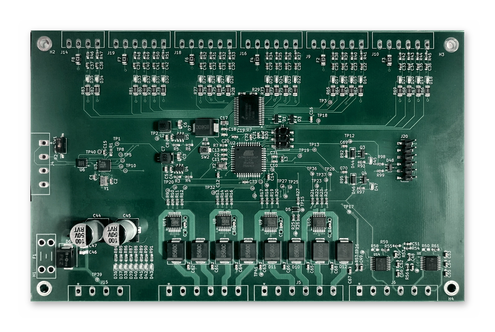

# Robust IO

A rugged industrial I/O board designed in KiCad 10.

## Status

- **Rev A:** fabricated and assembled by JLCPCB (5 bare boards, 2 assembled),
  ordered 2026-10-05. Board 1 is under bring-up: power rails, MCU, UART
  console and MCP2515 CAN controller are verified; the MC33978 input
  interface does not yet answer on SPI (see Bring-up log). Board 2 is
  partly disassembled from the reverse-polarity incident and needs C44/C45,
  U5, U1, U14 and one BTS7008 refitted.
- **Rev B:** change list collected below, not started.
- **Schematic:** complete across four hierarchical sheets. ERC clean.
- **PCB layout:** fully routed. DRC reports 0 errors and 4 library-mismatch
  warnings (J20, U1, U14, U7), which are intentional local footprint edits.

## Board

| Item | Value |
|---|---|
| Size | 160 x 100 mm, four M3 mounting holes |
| Layers | 4: F.Cu signal, In1 GND plane, In2 +24V plane, B.Cu signal |
| Copper | 2 oz outer, 1 oz inner |
| Minimum drill | 0.3 mm |
| Supply | 24 V nominal through a blade fuse (F1) and SMDJ24A TVS |
| Assembly | SMD parts on top side only; through-hole connectors and fuse holder hand-fitted |

## Architecture

| Sheet | Contents |
|---|---|
| `power` | Two TPS560430 buck regulators (+5V, +3.3V), input fuse, TVS, bulk capacitors |
| `processor` | ATmega1284P, MCP2515 + MCP2562 (CAN), crystals, ISP header (J1), UART header (J20), reset button |
| `inputs` | MC33978 22-channel switch detect with fused, filtered inputs and status LEDs |
| `outputs2` | Four BTS7008-2EPA dual high-side switches (8 outputs), two DRV8876 motor drivers |

## Connectors

- **J1:** 2x3 2.54 mm SMD header, AVR ISP (SPI is also on test points).
- **J20:** 1x6 2.54 mm SMD header, 3.3 V TTL UART in FTDI cable pinout.
  RX and TX have series resistors and a TVS array.
- **J14, J19, J18, J16, J9, J10 (top edge):** 3.5 mm pluggable terminal
  headers for the switch inputs, each with a fused supply pin and ground.
- **J15 (bottom edge):** 24 V supply input and ground.
- **J3, J5 (bottom edge):** high-side outputs OUT_0 to OUT_7, with +24V and
  ground.
- **J6 (bottom edge):** two motor driver outputs, with +24V and ground.
- **J4 (left edge):** CAN bus, +5V and ground. SW1 is next to it.

## Test points

41 test points (35 top, 6 bottom) cover the supply rails, SPI, UART, CAN
interrupt, driver control and sense lines, and ground. Positions and nets are
listed in `fab/robust-io-testpoints.csv`.

## Known limits of rev A

- **Supply polarity is not marked on the board.** J15 pins 1 and 2 (the
  square pad end, nearest F1) are +24V; pins 3 and 4 are GND. There is no
  reverse-polarity protection, so a reversed supply forward-biases D6 and the
  substrate diodes of every part on the rail. Both rev A boards were powered
  reversed during bring-up; see the Bring-up log.
- **MC33978 input LEDs read "input at ground".** Each input LED sits between
  +24V (2.2k) and the IC pin, so it lights when the input is pulled low.
  That is correct for switch-to-ground sensing, which is all rev A
  supports; switch-to-battery on an SP channel needs that channel's LED
  removed, because the 2.2k sources more current than the IC can sink.
- **BTS7008 GND pins have no series resistor.** The datasheet calls for
  47 ohm in the GND pin (RGND) and limits GND pin current to 50 mA.
- **CS_CAN has no pull-up.** With the MCU in reset (during ISP) the MCP2515
  can drive MISO; programming is unreliable unless the board is power-cycled
  first. Fit 10k from TP8 to TP1 if it keeps failing.
- **UART activity LEDs load the lines.** C69/C70 (10 nF) with the 1k series
  resistors give a 10 us edge, too slow for 115200 baud. The console runs at
  38400 on rev A.
- **C57 to C60 use a polarized symbol** in the schematic; the fitted parts
  are 50 V MLCCs and have no polarity.

- The BTS7008-2EPA is rated for a 28 V maximum supply. Use a regulated 24 V
  supply; do not connect directly to a charging battery system.
- Reverse polarity protection is the fuse and TVS only. There is no series
  reverse-blocking stage.
- The input polyfuses are rated 30 V, which is a small margin over 24 V.
- Y1 load capacitors (22 pF) have not been matched to the crystal's
  specified load capacitance.
- Regulator output tracks are 0.2 mm wide.

## Bring-up log (rev A)

- Both boards were first powered with the supply reversed. The symptom was a
  rail that read like a diode (0.5 V both ways, about 2 Ohm at 1 A), with
  whichever part had the lowest forward drop getting warm: D6, then U5,
  then the BTS7008 switches and DRV8876 drivers as parts were removed. With
  the supply in current limit at about 1 V nothing was damaged except C44
  and C45 on board 2, which vented after conducting in reverse for a long
  time. D6 was correctly placed on both boards; the earlier CPL change for
  it has been reverted.
- Board 1 after correct power: 5 V and 3.3 V present, fuses written
  (JTAG off), firmware flashed from a Raspberry Pi over J1, console at
  38400 8N1 on J20, MCP2515 answers. MC33978 does not answer the SPI check:
  continuity from the MCU to U7 pins 2, 3, 4, 16, 31 and 32 is good, VBATP
  and VDDQ are present, all four SPI modes were tried. The MISO pull-up
  test in firmware 0.3 (`MC33978 check frames` line in the banner) is the
  next step: 0xFFFFFFFF means the chip never drives MISO, 0x00000000 means
  it is selected but not shifting.
- With JTAG enabled (fresh chip) outputs 2 to 5 switch on by themselves.
  They go off once the fuses are written.
- On a Pi 4, avrdude leaves GPIO25 (reset) driven low after it exits. Run
  `pinctrl set 25 ip pu` (or `raspi-gpio set 25 ip pu`) after programming,
  or unplug J1 pin 5, before expecting the board to run.
- The Pi's mini UART (`/dev/ttyS0`) is unreliable for the console even at
  38400. Use an FTDI cable on J20 for the console and the Pi only for
  programming, or switch the Pi to the PL011 (`dtoverlay=disable-bt`).

## Rev B change list

- Mark + and - on the silkscreen at J15; add a reverse-polarity stage at the
  input (P-FET or ideal-diode controller) so a reversed supply does nothing.
- Input indicator LEDs: two-lead bicolour LED (red/green) in series with each
  input, replacing the 2.2k pull-ups R62 to R83, so the LED shows current in
  either direction and switch-to-battery works on the SP channels. Check the
  MC33978 comparator thresholds against the LED drop before committing.
- 47 ohm in series with each BTS7008 GND pin (U8 to U11).
- 10k pull-up on CS_CAN.
- C69/C70 to 220 pF, or drive the UART LEDs from the MCU.
- C57 to C60: non-polarized capacitor symbol.
- Test points: Keystone 5015 SMT loops on the rails, SPI, UART, interrupt,
  fault and analog sense lines; the four corner mounting holes are GND and
  take a ring lug, which covers the ground clips.
- SBC supply: 24 V to 5 V 5 A buck (Pi 5 / CM5) and 24 V to 12 V 3 A buck
  (BeagleBone Blue 9-18 V jack), each fused, on their own terminal block and
  fed from +24V ahead of the output switches so the host timeout cannot cut
  the host's own power.
- Rev A fab outputs move to `fab/revA/` and `docs/revA/` before any rev B
  output is generated.

## Files

- `robust-io.kicad_pro` - project file
- `robust-io.kicad_sch` - root sheet
- `power.kicad_sch`, `processor.kicad_sch`, `inputs.kicad_sch`, `outputs2.kicad_sch` - schematic sheets
- `robust-io.kicad_pcb` - PCB layout
- `robust-io.kicad_sym`, `sym-lib-table` - project symbol library
- `robust-io.kicad_dru` - custom design rules
- `DRC.rpt`, `ERC.rpt` - latest check reports

## Documentation (`docs/`)

| File | Content |
|---|---|
| [robust-io-schematic.pdf](docs/robust-io-schematic.pdf) | Schematic, all sheets |
| [layout-top.pdf](docs/layout-top.pdf), [layout-bottom.pdf](docs/layout-bottom.pdf) | Copper and silkscreen per side |
| [assembly-top.pdf](docs/assembly-top.pdf) | Assembly drawing with reference designators |
| [board-top.png](docs/board-top.png), [board-bottom.png](docs/board-bottom.png), [board-angle.png](docs/board-angle.png) | 3D renders |
| [robust-io-revA-top.jpg](docs/robust-io-revA-top.jpg), [robust-io-revA-top-board-only.jpg](docs/robust-io-revA-top-board-only.jpg) | Photos of the assembled rev A board (composite of several exposures, rectified to the board outline) |

Regenerate with `bash docs/make_docs.sh` after saving the schematic and board.

## Firmware (`firmware/`)

ATmega1284P firmware 0.3: UART service console (38400 8N1), CAN protocol with
host timeout, output current trip, motor control, EEPROM settings and a
self-test. Runs on rev A hardware; the MC33978 driver is unverified until the
chip answers (see Bring-up log). Build with `make` in `firmware/` (avr-gcc); `make fuses` and
`make flash` program the board from a Raspberry Pi wired to J1. See
[firmware/DESIGN.md](firmware/DESIGN.md) for the pin map, console commands,
CAN frame layouts and settings.

## Host tools (`tools/`)

Everything for talking to the board over CAN from a Pi, laptop or robot:
a DBC file, a Python package with the `robustio` command-line tool, a terminal
dashboard, a browser dashboard, a bring-up and end-of-line test runner that
writes a report per board, and a ROS 2 driver node. All of them also run
against the firmware simulator, so they can be used before hardware exists.
See [tools/README.md](tools/README.md).

## Fabrication outputs (`fab/`)

| File | Purpose |
|---|---|
| `make_gerbers.sh` | Plots Gerbers, drill files and the position file with kicad-cli, then zips the Gerbers |
| `gerbers/`, `robust-io-gerbers.zip` | Gerber and Excellon drill files |
| `robust-io-BOM-JLC-smd.csv` | JLCPCB assembly BOM, 50 lines, LCSC part number on every line |
| `robust-io-CPL-JLC.csv` | JLCPCB placement file |
| `cpl_rotation_offsets.json` | Per-part rotation corrections applied to the placement file |
| `kicad-pos.csv` | Raw KiCad position export |
| `robust-io-BOM-tht.csv` | Through-hole parts to fit by hand (fuse holder, terminal headers) |
| `robust-io-testpoints.csv` | Test point list with nets and positions |
| `robust-io-fab-all.zip` | Everything above in one archive |

To regenerate the Gerbers after a board change, save the board in KiCad and run:

    bash fab/make_gerbers.sh

The placement file is not produced by the script. JLCPCB's rotation
convention differs from KiCad's for some packages, so the rotation for each
part in `robust-io-CPL-JLC.csv` is the KiCad rotation plus the offset in
`cpl_rotation_offsets.json`. Regenerate it whenever parts move, and check
the result in JLCPCB's placement preview before ordering.

## Bring-up order

1. Fit F1 and J15. Apply 24 V from a current-limited supply with nothing else
   connected.
2. Check +5V (TP2) and +3.3V (TP1) against ground.
3. Wire the Raspberry Pi to J1 (`firmware/DESIGN.md` section 4) and run
   `make fuses`, then `make flash`, in `firmware/`. Do this before connecting
   any load to J3 or J5: until the fuses disable JTAG, outputs 2 to 5 can
   switch on by themselves. Release the reset line afterward
   (`pinctrl set 25 ip pu`).
4. On the J20 console (FTDI cable, 38400 8N1): `ver`, then `selftest`.
5. Connect CAN and run `robustio bringup --console /dev/serial0 --serial <n>`
   from `tools/`, which writes a report for the board.
6. Connect loads and enable the outputs and motor drivers one channel at a time
   (`robustio bringup --loads` once all are connected).

## License

See [LICENSE](LICENSE). Free for personal, educational, and open-source use.
For commercial licensing, contact ryan.lush@gmail.com.
